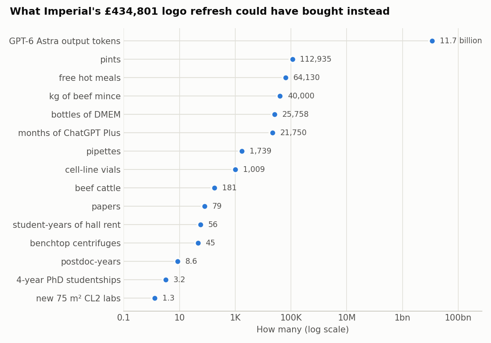
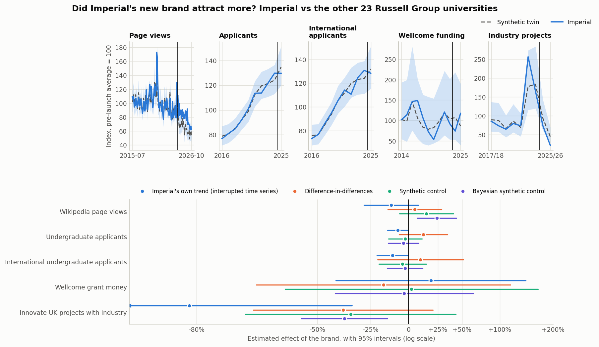

# What else could Imperial's new logo have bought?

**An open, sourced "what if" about Imperial College London's 2024 logo and brand refresh**

In February 2024 Imperial College London replaced its "Imperial College London" logo with a new "Imperial" wordmark. The College's own Freedom of Information disclosure puts the cost at **£434,801.47**. This repository works out what else that money could have bought, from beef and cows to PhD studentships, centrifuges, cell lines, culture medium, GPT tokens and new labs, and puts it all on one interactive page. It then tests the College's claim that the brand will help it attract students, staff, funding and partners, using four statistical methods and Bayesian inference.

🌐 **Interactive page:** <https://sthsci.github.io/imperial-logo-whatif/> (pick a budget, change the prices, fill your own basket)

🧮 **Every calculation, step by step:** [`docs/CALCULATIONS.md`](docs/CALCULATIONS.md)



## The bill

| | Amount | Status |
|---|---:|---|
| **Paid in total** (agencies, typeface, new signage, video and lanyards) | **£434,801.47** | Official ([Imperial FOI disclosure, March 2024](https://www.imperial.ac.uk/media/imperial-college/administration-and-support-services/secretariat/public/information-governance/Imperial-Brand-Project-FOI.pdf)) |
| The same in September 2026 money (ONS CPI) | £467,923 | Calculated |
| **The logo itself**: brand agencies plus the bespoke typeface | ≈ £299,800 | Our estimate |
| **Replacing the signs** ("decoration") across the campuses | ≈ £100,000 (£50k–£170k) | Our estimate |
| Promotional extras: brand animation video, lanyards | ≈ £35,000 | Our estimate |

- **Imperial will not say what the signs cost.** It refused to give the amount paid to each supplier under section 43 of the FOI Act ([reply of 26 March 2024](https://www.whatdotheyknow.com/request/cost_of_re_design_for_new_imperi)). So the split is a bottom-up estimate, and the page lets you move every slice.
- **Plot twist.** The 2002 rebrand, which introduced the "Imperial College London" logotype, cost £298,300 ([FOI reply, 2009](https://www.whatdotheyknow.com/request/re_branding_of_imperial_college)). That is **£573,134** in today's money, 22% more than the 2024 refresh. Together the two rebrands come to **£1.04 million** in today's money.

## What £434,801.47 buys instead

Default price first; the alternatives are selectable on the page. Every price links to its source in [`data/parameters.toml`](data/parameters.toml).

**Food and farm**
- 🥩 **40,000 kg of beef mince** (ONS average £10.87/kg). That is 352,734 quarter-pound burgers, or 4.2 years of everything Taste Imperial bought before it took beef off its menus in October 2024. Steak instead: 18,855 kg.
- 🐄 **181 finished beef steers** at £2,392 a head (AHDB deadweight price × average carcase), one for every 132 students. Or 143 freshly calved dairy heifers.
- 🍛 **Free food:** 64,130 hot meals at the £6.78 student price. That is enough for **every one of Imperial's 23,920 students to eat free 2.7 times**, or for **427 students to get free lunch every weekday of the teaching year**. With the £4 meal deal instead, 724 students get a year of lunches.

**Students and researchers**
- 🛏️ **56 student-years of hall rent** at the median £199 a week for 39 weeks. That is 74 at the cheapest room and 26 at the priciest.
- 🎓 **3.2 fully funded four-year PhD studentships** in London at 2026/27 UKRI rates (£34,043 a year: stipend, London weighting, fees and research costs), or one year of funding for 12 students. Over 3.5 years it is 3.6 studentships.
- 🧑‍🔬 8.6 years of an Imperial research associate's salary.

**In the lab**
- 🌀 **45 refrigerated benchtop centrifuges** (Eppendorf 5810 R, £9,498), 166 microcentrifuges, or 5.4 ultracentrifuges.
- 🧫 **1,009 vials of authenticated cell lines** (ATCC HEK-293 or HeLa, $577): a new line every working day for four years.
- 🧴 **25,758 bottles of DMEM** (12,879 litres). Stacked, they would stand 5.2 km tall, which is 59 Queen's Towers and higher than Mont Blanc. Or 1,184 bottles of fetal bovine serum.
- 🔬 **1.3 new 75 m² Containment Level 2 labs** at about £4,500 per m² before fittings and kit (2.1 small or 0.64 large ones). Or 10 start-up packages for new group leaders.
- 💧 1,739 pipettes · 📄 79 open-access papers in *Nature Communications*.

**AI**
- 🤖 **11.7 billion GPT-6 Astra output tokens** (OpenAI's flagship, $50 per million), enough to write 109,508 PhD theses. Or 58.3 billion input tokens, or 1.17 trillion output tokens from the cheapest model.
- 💬 **21,750 months of ChatGPT Plus**: 28 days for every Imperial student, or 1,813 years for one very patient PhD student.

**Perspective**
- £18.18 per Imperial student. £54 per signature on the petition against the logo (8,000+).
- Imperial's 2024/25 income (£1.49 bn) covers the bill in **2 h 33 min**: 0.03% of a year.
- 🍺 112,935 pints at the Union's £3.85 value price.

## Did the brand work?

Imperial says the new brand will help it attract students, staff, funding and partners. We compare Imperial with the other 23 Russell Group universities before and after the launch on 27 February 2024.



| Claim | Outcome (open data) | Own trend | Diff-in-diff | Synthetic control | Bayesian synthetic control | **Bayesian, placebo-calibrated** (open-minded prior) | P(effect > 0) |
|---|---|---:|---:|---:|---:|---:|---:|
| Attention | Wikipedia page views, monthly 2015–2026 | −12% | +4.9% | +14% | +24% | **+7.1%** (−7.3% to +23%) | 0.83 |
| Students | UCAS undergraduate applicants, 2016–2025 cycles | −7.9% | +12% | −2.5% | −3.8% | **−1.3%** (−11% to +9.6%) | 0.40 |
| Students | International applicants only | −11% | +9.4% | −4.4% | −2.7% | **−2.2%** (−14% to +11%) | 0.37 |
| Funding | Wellcome grant money, 2014–2026 | +18% | −17% | +2.3% | −3.3% | **+0.1%** (−17% to +21%) | 0.50 |
| Partners | Innovate UK projects with industry, 2017/18–2025/26 | −81% | −39% | −36% | −39% | **−2.7%** (−20% to +18%) | 0.39 |
| Staff | not tested (no open, comparable, recent source that scripts can download) | | | | | | |
| **All four claims** | random-effects average | | | | | **+1.3%** (−10% to +14%) | 0.59 |

- **No measurable effect.** Under the placebo test, none of the gaps is unusual: other universities drift as far over the same period (placebo p = 0.19 to 1.0). With an open-minded prior every Bayes factor is between 0.5 and 1.2, which is no real evidence either way.
- **The methods disagree, and that is informative.** In the 2025 cycle Imperial's applicants were flat (30,020) while the other 23 Russell Group universities grew by 5%. Imperial's own trend (growth of about 7% a year) then makes 2025 look like a shortfall of 8%. Difference-in-differences assumes Imperial would otherwise have kept pace with the others, so it mistakes Imperial's faster growth before the launch for an effect and finds +12%. The synthetic twin, a blend of mostly LSE and UCL that tracked Imperial's fast pre-launch growth, puts the gap at −2.5%, a size that is routine (placebo p = 0.67). The model-based Bayesian synthetic control is confident about attention (+24%) and industry projects (−39%), but gaps that size are common at the other universities. The verdicts therefore use the placebo-calibrated model.
- **The one hopeful sign is attention.** Imperial's Wikipedia page has had about 14% more readers than its synthetic twin since 2024. Four other universities drifted further, though, and Imperial rose from sixth to second in the [QS World University Rankings](https://www.imperial.ac.uk/news/253793/imperial-ranks-second-world-major-university/) four months after the launch.
- **The data could never settle it.** The brand pays for itself if it lifts the international intake by 0.16% (about 10 student-years at £43,300) or Wellcome funding by 1.7% for one year. The smallest effects these data can reliably detect are 29% and 284%. With a sceptic's prior the posterior average effect is +0.2%; with a brand agency's prior it is +4.7%. The data barely move either.

Every estimate, prior and posterior is in [`docs/CALCULATIONS.md`](docs/CALCULATIONS.md#7-did-the-brand-work) and `results/impact_estimates.csv`. On the page you can pick your own prior and watch the posterior update.

## Reproduce

```bash
pip install -r requirements.txt
make analysis   # results/, figures/, docs/data/site.json, docs/CALCULATIONS.md
make test       # pytest suite
make site       # serve the page at http://localhost:8766
make fetch      # optional: re-download the open data in data/impact/ (about 450 MB of raw files)
```

## Repository layout

| Path | Contents |
|---|---|
| `data/` | Every input with its source: `brand_costs.csv` (official figures), `parameters.toml` (unit prices, the estimated split, fixed assumptions), `imperial_facts.csv`, `cpi_d7bt.csv` (ONS CPI), `landmarks.csv` |
| `data/impact/` | The brand test: `design.toml` (outcomes, windows, priors, break-even inputs) and one CSV per source: Wikipedia page views, UCAS applicants, Wellcome grants, Innovate UK projects, each for all 24 Russell Group universities |
| `src/logowhatif/` | `model.py` (inflation, split, conversions), `impact.py` (interrupted time series, difference-in-differences, synthetic control, Bayesian synthetic control, placebo-calibrated Bayesian model, pooling), `report.py` (results, page data, CALCULATIONS.md, figures) |
| `scripts/` | `run_all.py` runs everything; `fetch_impact_data.py` downloads the open data |
| `results/` | `key_numbers.json`, `conversions.csv` (every price option), `impact_estimates.csv` (every method and prior) |
| `docs/` | The GitHub Pages site (`index.html`, `assets/`, `data/site.json`) and `CALCULATIONS.md` |
| `tests/` | `pytest` suite: the split adds up, prices have sources, USD prices use one exchange rate, each statistical method recovers a known effect, the data cover every university, page data matches the model |

## Method in brief

- **The bill.** The total is Imperial's own figure. The split is an estimate. Signage is sized bottom-up (identification signs, lettering and banners at the main campuses). The typeface and promotional items are sized from typical commission costs. The agencies get the remainder.
- **Today's money.** ONS CPI (D7BT): 2024 average 133.9; 2002–03 average 75.0; September 2026 144.1.
- **Conversions.** Budget ÷ unit price. Prices are UK list or average prices from 2026 where one exists. US list prices (ATCC, the ultracentrifuge, OpenAI) are converted at the ECB rate of 30 October 2026 ($1 = £0.74633).
- **The brand test.** Log outcomes for Imperial and the 23 other Russell Group universities. Four estimators: Imperial's own trend (interrupted time series); difference-in-differences; synthetic control; Bayesian synthetic control (conjugate regression shrunk towards the plain average, λ by marginal likelihood). With a single treated university, intervals and p-values come from placebo "rebrands" at every other university. The verdicts use a Bayesian model calibrated on those placebos: a Student-t likelihood for the effect, any normal prior, and a Savage–Dickey Bayes factor. A random-effects model pools one outcome per claim.

## Limitations

- The split of the £434,801.47 is our estimate. Only Imperial knows what the signs cost. If you know better, open an issue.
- Money is not interchangeable in practice. The brand was paid for from central budgets, not research grants, and a studentship or a lab needs people, space and running costs.
- The lab cost is a build cost (shell and core). It leaves out fit-out and equipment, so a working lab costs more.
- No public UK price was found for ECACC cell lines or for an ultracentrifuge. The ATCC price is the list price, not the non-profit one.
- Prices move, especially cattle, beef and AI tokens. Each input says when it was read.
- The brand test is early: one UCAS cycle and one or two years of grants since the launch. It uses proxies (applicants, one funder, one kind of industry partnership, page views). Anything that happened to Imperial alone after the launch, such as its rise to second in the QS ranking, is mixed in with the brand's effect. Staff are not tested, because HESA's staff record blocks automated downloads.

## Citation and licence

See `CITATION.cff`. Code: MIT. Text and figures: CC BY 4.0. Data are © their original publishers (sources listed in each file). Not an official Imperial College London publication.
Built with the help of an AI assistant (Claude, Anthropic); every input is traceable to a cited source.
